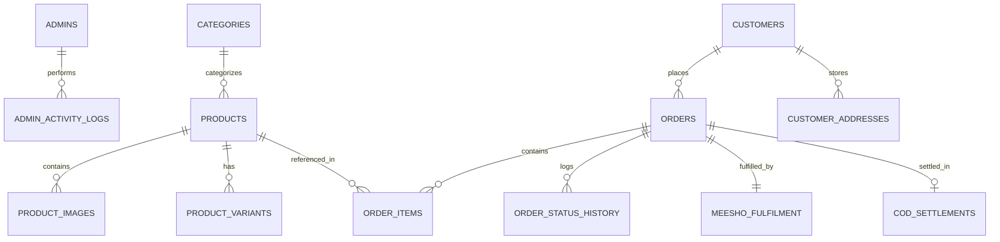

# Database Schema Specification

The database utilizes a relational design supporting multi-item orders, snapshot pricing, fulfillment workflows, and ledger-grade profit calculations.

## Entity Relationship Overview

## Detailed Tables

### 1. `admins`
- `id` (PK, Integer, Auto Increment)
- `email` (VARCHAR(255), Unique, Not Null, Indexed)
- `hashed_password` (VARCHAR(255), Not Null)
- `name` (VARCHAR(255), Default "Admin")
- `is_active` (BOOLEAN, Default True)
- `created_at` / `updated_at` (TIMESTAMP)

### 2. `categories`
- `id` (PK, Integer)
- `name` (VARCHAR(255), Unique, Not Null)
- `slug` (VARCHAR(255), Unique, Indexed)
- `description` (TEXT)
- `image_url` (VARCHAR(500))
- `icon` (VARCHAR(100))
- `is_active` (BOOLEAN, Default True)
- `sort_order` (INTEGER, Default 0)

### 3. `products`
- `id` (PK, Integer)
- `name` (VARCHAR(500), Not Null, Indexed)
- `slug` (VARCHAR(500), Unique, Indexed)
- `description` (TEXT)
- `specifications` (JSON)
- `category_id` (FK -> categories.id)
- `purchase_cost` (FLOAT) — *Confidential Sourcing Cost*
- `selling_price` (FLOAT, Not Null) — *Customer COD Price*
- `original_price` (FLOAT) — *MRP / Reference Price*
- `discount_percentage` (FLOAT)
- `meesho_link` (VARCHAR(1000)) — *Confidential Supplier Link*
- `is_active` (BOOLEAN, Default True)
- `is_featured` (BOOLEAN, Default False)
- `cod_available` (BOOLEAN, Default True)
- `stock_quantity` (INTEGER, Default 100)
- `total_orders` (INTEGER, Default 0)
- `average_rating` (FLOAT)

### 4. `product_images`
- `id` (PK, Integer)
- `product_id` (FK -> products.id, On Delete Cascade)
- `image_url` (VARCHAR(1000), Not Null)
- `is_primary` (BOOLEAN, Default False)
- `sort_order` (INTEGER, Default 0)

### 5. `product_variants`
- `id` (PK, Integer)
- `product_id` (FK -> products.id, On Delete Cascade)
- `variant_type` (VARCHAR(50)) — 'size' or 'color'
- `value` (VARCHAR(100), Not Null)
- `is_available` (BOOLEAN, Default True)

### 6. `customers`
- `id` (PK, Integer)
- `name` (VARCHAR(255), Not Null)
- `mobile` (VARCHAR(15), Not Null, Indexed)
- `alternate_mobile` (VARCHAR(15))
- `email` (VARCHAR(255))
- `created_at` (TIMESTAMP)

### 7. `orders`
- `id` (PK, Integer)
- `order_id` (VARCHAR(50), Unique, Indexed) — e.g., 'ORD-20241201-0001'
- `customer_id` (FK -> customers.id, Not Null)
- `status` (VARCHAR(50), Default "NEW")
- `payment_method` (VARCHAR(50), Default "COD")
- `total_amount` (FLOAT, Not Null)
- `delivery_charges` (FLOAT, Default 0.0)
- `flat_number` (VARCHAR(255), Not Null)
- `street` (VARCHAR(500), Not Null)
- `landmark` (VARCHAR(255))
- `city` (VARCHAR(255), Not Null)
- `state` (VARCHAR(255), Not Null)
- `pincode` (VARCHAR(10), Not Null)
- `admin_notes` (TEXT)
- `cancellation_reason` (TEXT)
- `created_at` / `updated_at` (TIMESTAMP)

### 8. `order_items`
- `id` (PK, Integer)
- `order_id` (FK -> orders.id, On Delete Cascade)
- `product_id` (FK -> products.id)
- `product_name` (VARCHAR(500), Not Null) — *Immutable Snapshot*
- `product_image` (VARCHAR(1000))
- `selected_size` (VARCHAR(100))
- `selected_color` (VARCHAR(100))
- `quantity` (INTEGER, Not Null, Default 1)
- `unit_price` (FLOAT, Not Null) — *Price Snapshot at Time of Order*
- `total_price` (FLOAT, Not Null)

### 9. `meesho_fulfilment`
- `id` (PK, Integer)
- `order_id` (FK -> orders.id, Unique, Not Null)
- `meesho_order_id` (VARCHAR(255), Indexed)
- `meesho_product_link` (VARCHAR(1000))
- `actual_purchase_cost` (FLOAT)
- `reselling_margin` (FLOAT)
- `order_placed_date` (TIMESTAMP)
- `expected_delivery_date` (TIMESTAMP)
- `tracking_info` (VARCHAR(500))
- `is_ordered_on_meesho` (BOOLEAN, Default False)
- `internal_notes` (TEXT)

### 10. `order_status_history`
- `id` (PK, Integer)
- `order_id` (FK -> orders.id, On Delete Cascade)
- `status` (VARCHAR(50), Not Null)
- `note` (TEXT)
- `changed_by` (VARCHAR(100))
- `created_at` (TIMESTAMP)

